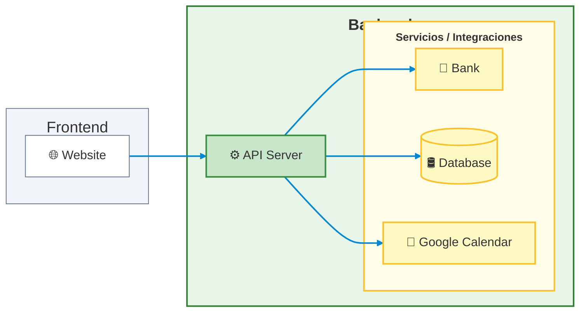

# Rivendel — Backend

API server for Rivendel, a case management platform for labor conciliators designated under DICLO (Dirección de Conciliación Laboral Obligatoria) in Santiago del Estero, Argentina.

[Live API](<url>) · [Frontend repo](<url>) · [Case study](<url>)

## Overview

This backend serves the Rivendel frontend, exposing a REST API for managing labor claims, claim parties (claimants and respondents), their sponsoring counsels, settlement clause drafting, user accounts, and Google Calendar synchronization for scheduling conciliation hearings.

## Tech Stack

- **Framework:** NestJS
- **ORM:** Prisma
- **Database:** MySQL (hosted on Aiven)
- **Auth:** JWT with refresh tokens, cross-domain session cookies
- **Validation:** Joi (environment config), class-validator (DTOs)
- **Security:** `@nestjs/throttler` (rate limiting), `helmet`, JWT with refresh tokens
- **Deployment:** Render

## Architecture



The backend and frontend run on different domains, which required secure, partitioned, cross-domain session cookies (`httpOnly`, `sameSite: 'none'`, `secure: true`, `partitioned: true`) instead of relying on same-origin defaults.

## Key Technical Decisions

**Selective multi-user data isolation.** User isolation is implemented at the data layer via a `userId` foreign key on user-owned tables, validated against a dedicated users table. Claims and parties are scoped per user and never visible across accounts. Sponsoring counsels, however, are deliberately shared across all users rather than duplicated per account, since they represent the actual pool of local-jurisdiction lawyers — a real-world entity that exists independently of which conciliator is using the system, making per-user duplication both incorrect and wasteful.

**Diagnosing TLS and driver-level database connectivity issues with Aiven.** Connecting to a managed MySQL instance on Aiven surfaced a chain of infrastructure-level problems that don't show up in local development: DNS resolution failures, TLS/SSL handshake errors with the MariaDB client, and IP allowlist restrictions that had to be configured against Render's dynamic outbound IPs. Resolving this required working through certificate handling via `NODE_EXTRA_CA_CERTS`, careful staged testing of IP filtering rules to avoid locking out the production database, and debugging shadow-database permission errors and migration checksum drift along the way.

**OAuth2 over a service account for Google Calendar integration.** Scheduling conciliation hearings required syncing events to each conciliator's own Google Calendar, not a shared service account calendar. This meant implementing a full OAuth2 flow — `access_type: 'offline'` and `prompt: 'consent'` to obtain refresh tokens, and passing `userId` through the OAuth `state` parameter — with refresh tokens stored in MySQL via Prisma, so each user authorizes and syncs to their own calendar.

**Keeping a free-tier backend awake.** Render's free tier spins down the service after about 15 minutes of inactivity, which is unacceptable for a production tool conciliators rely on during working hours. Instead of a plain cron job, the backend is kept warm with Upstash QStash: scheduled messages are queued every 14 minutes, just under Render's inactivity threshold, and delivered to a dedicated endpoint on the backend. That endpoint is protected by a guard that verifies the `Upstash-Signature` header, so only requests actually signed by QStash are accepted. The global rate limiter runs before that guard, which means forged requests are cut off before any signature verification is attempted.

**Layered application-level protection for a free-tier deployment.** The production and demo environments run on free tiers (Render, Aiven), so the real risk is not volumetric network attacks, which the platform and Vercel's CDN already filter, but application-level abuse of expensive endpoints and exhaustion of the database connection limit. The API registers `@nestjs/throttler` as a global guard with a default limit of 100 requests per minute per IP, and stricter limits on the endpoints that are unauthenticated or costly: 5 requests per minute on login, and a tight limit on the endpoint that queries the third-party bank API. Because Render sits behind a reverse proxy, the app sets `trust proxy` so the limiter sees the client's real IP instead of the proxy's. `helmet` adds standard security headers, request validation uses a `ValidationPipe` with `whitelist: true`, listings are paginated with a hard cap on page size, and the Prisma connection pool is limited through the connection string so a traffic spike can't exhaust the managed database's connections. Cloudflare with Turnstile in front of the API was evaluated and deliberately deferred, since it requires a custom domain and the current measures cover the observed risk.

**Short-lived access tokens with rotating, revocable refresh tokens.** Authentication uses two JWTs signed with different secrets. The access token is short-lived and held only in the frontend's memory, so it is never exposed to persistent storage. The refresh token is long-lived and travels exclusively in an `httpOnly` cookie whose `Path` is restricted to the refresh endpoint, which keeps it out of reach of client-side scripts and prevents the browser from sending it on any other request. On every refresh the server issues a new refresh token and invalidates the previous one (rotation), and the current token is persisted against the user record, so a token that has already been used or replaced no longer matches and is rejected. Logout clears that stored value, which revokes the session on the server instead of merely deleting the cookie in the browser. Since the access token lives in memory, a page reload loses it, and the frontend recovers it transparently by calling the refresh endpoint with the cookie.

*(Full technical detail for other decisions — such as third-party API integration behind anti-bot protection — is covered below or in the [case study](<url>).)*

## Other Technical Notes

- **Bank verification integration:** Verifying CBU (bank account) data for settlement payments requires querying a third-party banking API protected by F5 BIG-IP anti-bot measures and a Java session (`JSESSIONID`). This is handled with a dedicated axios client using a cookie jar (`axios-cookiejar-support` + `tough-cookie`) that performs a warm-up request before hitting the real endpoint.
- **Environment configuration:** Multi-environment config via NestJS `ConfigModule` with Joi schema validation and dynamic `envFilePath` resolution; secrets are injected directly in production via Render's Secret Files feature.

## Getting Started

### Prerequisites
- Node version, package manager, MySQL instance

### Installation
```bash
git clone <repo>
cd <repo>
pnpm install
```

### Environment Variables
```bash
# database
DATABASE_URL=                  # MySQL connection string (include pool params such as connection_limit and pool_timeout)
DATABASE_CA_CERT=              # database CA certificate, in plain text (PEM)
DATABASE_CA_TEMP_PATH=         # directory where the CA certificate file is written at startup
DATABASE_CA_NAME=              # file name used to store the CA certificate

# app
NODE_ENV=                      # runtime environment (e.g. local, production)
FRONTEND_URL=                  # base URL of the frontend (optional)
ALLOWED_ORIGINS=               # regex matching the origins allowed by CORS

# auth
JWT_ACCESS_SECRET=             # secret used to sign and verify access tokens
JWT_ACCESS_EXPIRES_IN=         # access token lifetime, in seconds
JWT_REFRESH_SECRET=            # secret used to sign and verify refresh tokens
JWT_REFRESH_EXPIRES_IN=        # refresh token lifetime, in seconds
SAME_SITE=                     # cookie SameSite policy: lax, none or strict (none requires secure cookies)
USE_SECURE_COOKIES=            # boolean, whether cookies are flagged as Secure
PATH_REFRESH_TOKEN=            # route of the token refresh endpoint; also the Path of the refresh_token cookie, so it is only sent to that route
REFRESH_TOKEN_COOKIE_MAX_AGE=  # refresh token cookie lifetime, in milliseconds

# Google Calendar (OAuth 2.0)
GOOGLE_CLIENT_ID=              # OAuth 2.0 client ID from Google Cloud
GOOGLE_CLIENT_SECRET=          # OAuth 2.0 client secret from Google Cloud
GOOGLE_REDIRECT_URI=           # URL Google redirects to after the user grants consent (must match the one registered in Google Cloud)

# Upstash QStash
QSTASH_CURRENT_SIGNING_KEY=    # current signing key, used to verify the Upstash-Signature header
QSTASH_NEXT_SIGNING_KEY=       # next signing key, used during key rotation
```


### Running locally
```bash
npx prisma migrate deploy
pnpm start:dev
```

## Testing

The test suite runs on **Jest** with `ts-jest`, `@nestjs/testing`, `supertest` and `jest-mock-extended`, and consists of 41 suites and 211 tests. Coverage sits at 97.6% of statements, 91.2% of branches, 93.5% of functions and 97.7% of lines, against a global threshold of 90% enforced on every metric, so the run fails if coverage drops below it. Tests are fully isolated: Prisma, `ConfigService`, the Google client and `axios` are replaced with strictly typed mocks, so no test touches a real database or the network. The suite covers authentication and session handling, per-user data isolation by `userId` (including the intentionally shared sponsoring counsels), CRUD operations and DTO validation, the Google Calendar OAuth2 flow, CBU verification against the third-party bank API, the signature guard that protects the QStash keep-alive endpoint, the Joi environment validation and the custom validation pipes. A small end-to-end suite exercises the `/health` endpoint over HTTP. Linting reports zero errors and zero warnings and the project type-checks cleanly, tests included, with no `eslint-disable`, `@ts-ignore` or rule overrides.

```bash
pnpm test        # run once
pnpm test:cov    # run with coverage report and threshold check
pnpm test:e2e    # end-to-end tests with supertest
```

## Related Repository

This is the backend half of a full-stack project. Frontend (React + Vite): [link]

## Roadmap

These items are out of scope for the current MVP but represent natural next steps for the product:

- **ARCA invoicing for settlement agreements processed in a given period**
  - Requires linking the user's account to their ARCA account (ARCA is Argentina's federal tax collection agency)
  - Each conciliation, whether settled or failed, has an associated amount based on its resolution type
  - Each claim included in an invoice should be marked as processed, with the related invoice number attached
  - Generated invoices should be stored, including invoice number, date, total amount, and description

- **Document management for conciliation-related files**
  - Sponsoring counsels and their parties submit documentation related to the conciliation, such as powers of attorney, salary settlement statements, and formal notices (telegrams)
  - This documentation could be stored in Google Drive folders linked to the corresponding claim
  - This would require linking the user's account to their Google Drive, following the same OAuth2 pattern already used for Google Calendar

- **Add caching (e.g. Redis) for database queries**

- **Broaden end-to-end test coverage beyond the health endpoint**, exercising the authentication flow and the claims lifecycle against a test database

## License

MIT © <Your Name>
