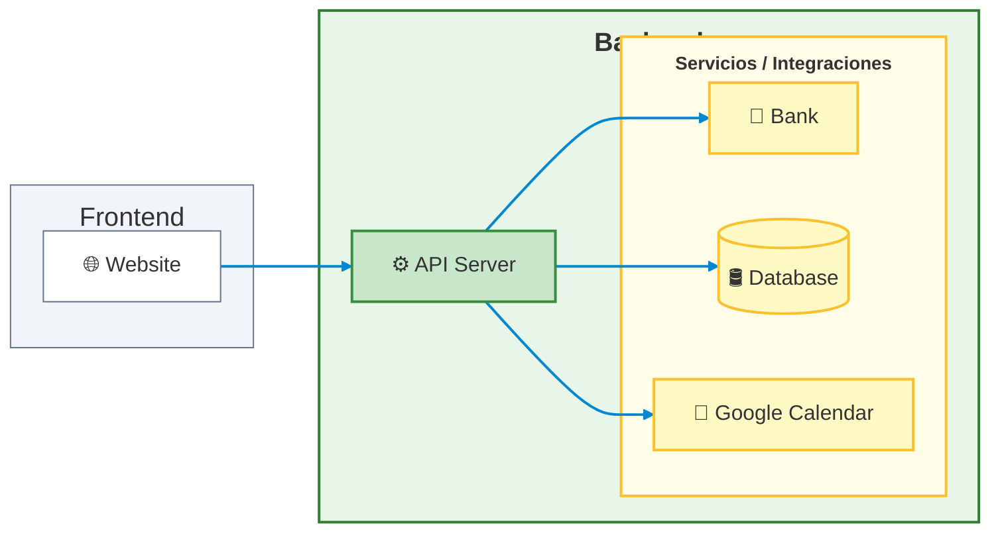

# Rivendel — Backend

API server for Rivendel, a case management platform for labor conciliators designated under DICLO (Dirección de Conciliación Laboral Obligatoria) in Santiago del Estero, Argentina.

[Live API](<url>) · [Frontend repo](<url>) · [Case study](<url>)

## Overview

This backend serves the Rivendel frontend, exposing a REST API for managing labor claims, claim parties (claimants and respondents), their sponsoring counsels, settlement clause drafting, user accounts, and Google Calendar synchronization for scheduling conciliation hearings.

## Tech Stack

- **Framework:** NestJS
- **ORM:** Prisma
- **Database:** MySQL (hosted on Aiven)
- **Auth:** JWT with refresh tokens, cross-domain session cookies
- **Validation:** Joi (environment config), class-validator (DTOs)
- **Deployment:** Render

## Architecture



The backend and frontend run on different domains, which required secure, partitioned, cross-domain session cookies (`httpOnly`, `sameSite: 'none'`, `secure: true`, `partitioned: true`) instead of relying on same-origin defaults.

## Key Technical Decisions

**Selective multi-user data isolation.** User isolation is implemented at the data layer via a `userId` foreign key on user-owned tables, validated against a dedicated users table. Claims and parties are scoped per user and never visible across accounts. Sponsoring counsels, however, are deliberately shared across all users rather than duplicated per account, since they represent the actual pool of local-jurisdiction lawyers — a real-world entity that exists independently of which conciliator is using the system, making per-user duplication both incorrect and wasteful.

**Diagnosing TLS and driver-level database connectivity issues with Aiven.** Connecting to a managed MySQL instance on Aiven surfaced a chain of infrastructure-level problems that don't show up in local development: DNS resolution failures, TLS/SSL handshake errors with the MariaDB client, and IP allowlist restrictions that had to be configured against Render's dynamic outbound IPs. Resolving this required working through certificate handling via `NODE_EXTRA_CA_CERTS`, careful staged testing of IP filtering rules to avoid locking out the production database, and debugging shadow-database permission errors and migration checksum drift along the way.

**OAuth2 over a service account for Google Calendar integration.** Scheduling conciliation hearings required syncing events to each conciliator's own Google Calendar, not a shared service account calendar. This meant implementing a full OAuth2 flow — `access_type: 'offline'` and `prompt: 'consent'` to obtain refresh tokens, and passing `userId` through the OAuth `state` parameter — with refresh tokens stored in MySQL via Prisma, so each user authorizes and syncs to their own calendar.

**Keeping a free-tier backend awake.** Render's free tier spins down the service after inactivity, which is unacceptable for a production tool conciliators rely on during working hours. A dedicated `/health` endpoint is pinged every 10 minutes between 8am and 10pm (GMT-3) via a free external cron service, keeping cold-start latency out of the conciliators' workflow.

*(Full technical detail for other decisions — such as third-party API integration behind anti-bot protection — is covered below or in the [case study](<url>).)*

## Other Technical Notes

- **Bank verification integration:** Verifying CBU (bank account) data for settlement payments requires querying a third-party banking API protected by F5 BIG-IP anti-bot measures and a Java session (`JSESSIONID`). This is handled with a dedicated axios client using a cookie jar (`axios-cookiejar-support` + `tough-cookie`) that performs a warm-up request before hitting the real endpoint.
- **Environment configuration:** Multi-environment config via NestJS `ConfigModule` with Joi schema validation and dynamic `envFilePath` resolution; secrets are injected directly in production via Render's Secret Files feature.

## Getting Started

### Prerequisites
- Node version, package manager, MySQL instance

### Installation
```bash
git clone <repo>
cd <repo>
pnpm install
```

### Environment Variables